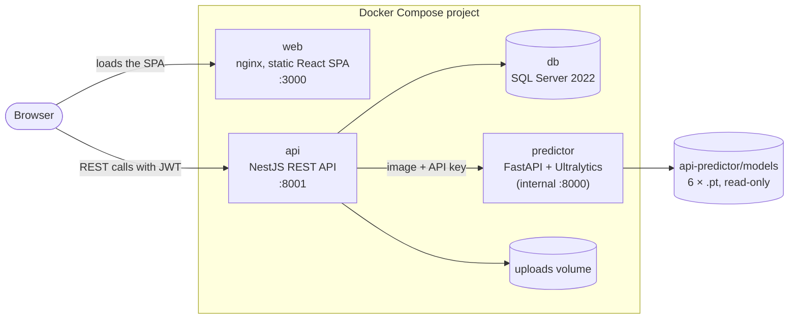

# ANA Pattern Classifier

A web application for clinical immunology laboratories that classifies antinuclear antibody (ANA)
patterns in HEp-2 indirect immunofluorescence (IIF) images. A laboratory user registers or finds
the patient, uploads the images of an exam, and gets an AI classification of each image following
the ICAP nomenclature (AC-0 to AC-29) from a three-level hierarchy of YOLOv8 classifiers
(general → competent → expert). The user sets the dilution of each image, then **verifies** the
AI result or **corrects** it; nothing is final until a person has reviewed it. Finalized exams
become clinical reports, every change is recorded in an audit trail, and
administrators can follow model accuracy and manage users.

The repository contains three services: a React web app (`frontend/`), a NestJS REST API with SQL
Server (`api/`) and a FastAPI prediction service (`api-predictor/`), plus the notebooks that trained
the six model checkpoints (`training/`). The checkpoints are included in `api-predictor/models/`
(see [Model training and checkpoints](#model-training-and-checkpoints)).

## Contents

- [Feature tour](#feature-tour)
- [Architecture](#architecture)
- [Tech stack](#tech-stack)
- [Repository layout](#repository-layout)
- [Quick start with Docker Compose](#quick-start-with-docker-compose)
- [Local development](#local-development)
- [Configuration](#configuration)
- [Testing](#testing)
- [Security notes](#security-notes)
- [Data and privacy](#data-and-privacy)
- [Fresh database required](#fresh-database-required)
- [Known limitations](#known-limitations)
- [Model training and checkpoints](#model-training-and-checkpoints)
- [Further documentation](#further-documentation)

## Feature tour

There are two roles: **Administrator** (`ADMIN`) and **Standard** (`STANDARD`). The API enforces
the role of every route; the web app also hides and blocks (403 page) the administrator screens.

### Every signed-in user

| Screen | What it does |
|---|---|
| **Login** | Username and password. The session renews itself with a refresh token; **Log Out** revokes both tokens. **Forgot your password?** sends a reset request to the administrators (see below). Too many attempts from one address are answered with "Too many requests. Please try again later." |
| **Home** | *Pending Exams*: the shared queue of results saved for later (status `PENDING`), 5 per page, with a search box for patient name or document number that searches every pending exam on the server (from page 1, after a short pause in typing). Open an exam to see its images and predictions, then **Continue Analysis** or **Verify** it (with confirmation). |
| **ANA Analysis** | 1. Find the patient by document type and number, or register a new one. 2. Add HEp-2 images (drag and drop or file picker; JPEG, PNG, BMP, TIFF; up to 10 MB each; at most 20 images per result, saved ones included, a limit the API enforces too). 3. **Analyze**: each image is classified by the AI and shown with its ICAP code, pattern name and a confidence badge; the API signs each answer, and an image whose answer is incomplete is marked as failed and can be analyzed again. 4. Set the dilution of each image (1:80 to 1:2560). 5. Optionally **Compare** an image with the reference gallery (zoom and pan), which opens on the image's predicted class when the gallery has it. 6. Save: **Save for Later** (stays pending), **Confirm** the AI results (verified), or **correct** individual images with a class selector grouped by hierarchy level (corrected; the model's own class is not offered). The page's **Observations** belong to the exam; the **Correction Notes** of the correction form are stored with the corrections only. Each image is saved with the AI answer exactly as signed by the API (an unsigned image must be analyzed again first); disagreement is recorded as a correction. **Continue Analysis** saves everything (new images, dilutions, corrections, observations, status) in one request, so a failed save can simply be retried; the dilution of a saved image can also be changed on its own (**Save Changes**). Leaving the page with unsaved images or edited observations or dilutions (sidebar, **Log Out**, reload or closing the tab) asks for confirmation first. |
| **Reports** | Search finalized exams (verified or corrected) by patient name or document number, and open the clinical report: laboratory header, patient, responsible physician, every image with its final pattern and dilution, observations. **Print** prints only the report on A4 pages (the browser's print dialog can also save it as PDF). |

Standard users see their own results plus the shared pending queue, and cannot correct an exam
that has already been verified. A verified exam is locked for everyone: no new images, dilution
or observation changes; only an administrator's correction reopens it (it becomes corrected).

### Administrators only

| Screen | What it does |
|---|---|
| **Audit Trail** | Every recorded action (create, update, delete, password-reset events) with actor, role, date and affected entity; detail view with field-by-field changes and the images involved; filters by actor name, activity and date range (days of the browser's time zone), applied on the server; a start date after the end date is flagged on the field and not applied; **Export CSV** of every matching record, across all pages. |
| **Analytics** | Model accuracy and correction rate, computed per image over verified and corrected exams, with a date range filter (days of the laboratory time zone, `APP_TIMEZONE`). |
| **User Management** | Create users, edit name, email, license number, role and active status, deactivate users. Role changes and deactivations apply to open sessions from their next request. |
| **Password-reset approval** | Open the reset link emailed to the administrator, confirm with administrator credentials, and set the user's new password. |

A **reference image gallery** can back the Compare view. It is empty by default: no images are
shipped (see [api/uploads/reference/README.md](api/uploads/reference/README.md)).

## Architecture



- The **web** container serves only static files. The SPA in the browser calls the **api**
  directly (`REACT_APP_API_BASE_URL`, CORS restricted to `FRONTEND_URL`).
- The **api** is the single entry point: authentication, roles, validation, storage, audit trail,
  and a server-side proxy to the predictor that signs every prediction so it can be saved only
  unchanged. The predictor's API key never reaches the browser.
- The **predictor** is not published on the host; it loads the six checkpoints at startup and
  classifies one image at a time.
- **db** and the **uploads** volume hold all persistent data. The one-shot **db-init** service
  creates the database and a dedicated SQL login for the API (`db_owner` on that database only);
  the API never connects as `sa`.

Details, diagrams and design decisions: [docs/ARCHITECTURE.md](docs/ARCHITECTURE.md).

## Tech stack

| Layer | Technology (version resolved in the lockfiles) |
|---|---|
| Web app | React 19.1.1, React Router 7.8.2, Create React App (`react-scripts` 5.0.1), Tailwind CSS 3.3.3, axios 1.11.0, lucide-react 0.542.0; served by nginx (`nginxinc/nginx-unprivileged:alpine`) |
| REST API | Node.js 22, NestJS 11.1.6, TypeScript 5.9.2, TypeORM 0.3.26 with `mssql` 11.0.1, Passport (`passport-jwt` 4.0.1, `passport-local`), bcrypt 6.0.0, class-validator 0.14.2, helmet 8.3.0, `@sendgrid/mail` 8.1.6 |
| Database | Microsoft SQL Server 2022 (`mcr.microsoft.com/mssql/server:2022-latest`) |
| Prediction service | Python 3.13, FastAPI 0.116.1, Uvicorn 0.35.0, Ultralytics 8.3.198 (YOLOv8-cls), PyTorch 2.8.0 and torchvision 0.23.0 (CPU builds), OpenCV 4.12.0.88, NumPy 2.2.6, Pillow 11.3.0, pydantic-settings 2.10.1; pip with pinned `requirements.txt` |
| Tests and tooling | Jest 30 + Supertest (API), Jest + React Testing Library (web), pytest 9.1.1 + httpx (predictor), ESLint + Prettier, Ruff 0.16.8 |

## Repository layout

```text
.
├── docker-compose.yml          Full stack: db, db-init, predictor, api, web
├── env.example                Compose configuration (copy to .env)
├── docs/
│   ├── API.md                  Every endpoint of the API and the prediction service
│   └── ARCHITECTURE.md         Components, flows, classification, lifecycle, data model
├── frontend/                   React SPA
│   ├── src/pages/              Screens (login, dashboard pages, reset password, 403/404)
│   ├── src/components/         UI, analysis, reports, audit trail, users
│   ├── src/services/api/       One client module per API area
│   ├── src/config/             axios client, class mapping, design tokens, lab profile
│   ├── Dockerfile, nginx.conf  Production image
│   └── env.example
├── api/                        NestJS REST API
│   ├── src/modules/            auth, users, patients, predictions, results, reports,
│   │                           traceability (audit trail), files, database (+ migrations)
│   ├── src/entities/           TypeORM entities and enums
│   ├── src/DTOs/               Request validation and response shapes
│   ├── src/scripts/            create-admin-user.ts (seed the first administrator)
│   ├── test/                   End-to-end tests (real SQL Server, fake predictor)
│   ├── uploads/                Runtime image storage (predictions/, reference/)
│   ├── Dockerfile
│   └── env.example
├── api-predictor/              FastAPI prediction service
│   ├── app/core/               Settings, API-key auth, class mapping and hierarchy
│   ├── app/routers/            /api/v1/predict, /api/v1/health
│   ├── app/services/           Preprocessing, patching, hybrid voting, hierarchy
│   ├── models/                 The six trained .pt checkpoints
│   ├── tests/                  pytest suite with fake models
│   ├── requirements.txt, requirements-dev.txt, Dockerfile
│   └── env.example
└── training/                   Model training, one folder per model (01_general … 06_expert_mitotic)
    ├── <model folder>/         Notebooks, utils/ and the Ultralytics runs/ of that model
    └── README.md
```

## Quick start with Docker Compose

Requirements: Docker Engine with Compose v2, several gigabytes of free disk space (the SQL Server
and PyTorch images are large), and the six model checkpoints.

1. **Configure.** Copy the example file and replace every `change-me` value:

   ```bash
   cp env.example .env
   ```

   | Variable | What to set |
   |---|---|
   | `MSSQL_SA_PASSWORD` | SQL Server `sa` password (at least 8 characters with three of: uppercase, lowercase, digits, symbols) |
   | `DB_APP_PASSWORD` | Password of the API's own SQL login (`DB_APP_USERNAME`, default `ana_app`); same policy |
   | `JWT_SECRET` | Long random string, e.g. `openssl rand -hex 32` |
   | `PREDICTION_SIGNING_SECRET` | Another long random string: the key that signs every prediction |
   | `PREDICTOR_API_KEY` | Long random string shared by the API and the predictor |
   | `ADMIN_PASSWORD` | Password of the first administrator (at least 8 characters) |

   The API container runs with `NODE_ENV=production` and **refuses to start** while `JWT_SECRET`,
   `PREDICTION_SIGNING_SECRET`, `PREDICTOR_API_KEY` or `SENDGRID_API_KEY` still starts with
   `change-me`; the two database passwords are not checked, so replace them too. Avoid `$` in
   values. Password resets need email under Compose: set
   `SENDGRID_API_KEY` and a verified `SENDGRID_FROM_EMAIL` (without a key the reset link is
   neither delivered nor logged, see [Configuration](#configuration)).

2. **Build and start:**

   ```bash
   docker compose up --build -d
   ```

   Start order: `db-init` waits for a healthy `db`, creates the database `DB_NAME` if it is
   missing and creates (or updates the password of) the login `DB_APP_USERNAME` with `db_owner` on
   that database only; `api` waits for `db-init` and for a healthy `predictor` (checkpoints
   loaded), connects with that login, applies the database migrations and starts; `web` serves
   the SPA. The first build downloads the base
   images and the CPU PyTorch wheels and takes several minutes. Follow progress with `docker compose ps` and
   `docker compose logs -f api predictor`.

3. **Create the first administrator** (uses the `ADMIN_*` values of `.env`; safe to repeat):

   ```bash
   docker compose exec api node dist/scripts/create-admin-user.js
   ```

4. **Open http://localhost:3000** and sign in with `ADMIN_USERNAME` / `ADMIN_PASSWORD`. Create the
   other users under **User Management**.

Stop with `docker compose down`. `docker compose down -v` also deletes the database and the
uploaded images (volumes `db-data` and `uploads`).

Only the web app (port 3000) and the API (port 8001) are published on the host. To serve the app
under another host name, set `REACT_APP_API_BASE_URL`, `API_ORIGIN`, `FRONTEND_URL` and
`API_BASE_URL` consistently and rebuild the web image (`docker compose build web`): the API URL is
compiled into the JavaScript bundle.

## Local development

Requirements: Node.js 22 with npm, Python 3.13 with pip, and Docker (for SQL Server).

### 1. Database

The Compose `db` service is not published on the host, so for local development run SQL Server in
its own container and create an empty database (the password must satisfy the SQL Server policy):

```bash
docker run -d --name ana-dev-db -e ACCEPT_EULA=Y -e MSSQL_SA_PASSWORD='Dev-Passw0rd!' \
  -p 1433:1433 mcr.microsoft.com/mssql/server:2022-latest
docker exec ana-dev-db /opt/mssql-tools18/bin/sqlcmd -C -S localhost -U sa -P 'Dev-Passw0rd!' \
  -Q "CREATE DATABASE ana_classifier"
```

(Wait a few seconds after `docker run` before creating the database.)

### 2. Prediction service (port 8000)

```bash
cd api-predictor
cp env.example .env              # set API_KEYS to a long random key
python -m venv .venv
source .venv/bin/activate        # Windows: .venv\Scripts\activate
pip install -r requirements-dev.txt
uvicorn main:app --reload --port 8000
```

`DEBUG=true` in the example file enables the OpenAPI docs at http://localhost:8000/docs. On Linux,
OpenCV needs the system library `libgl1`. Check readiness with
`curl http://localhost:8000/api/v1/health` → `{"status":"ok","models_loaded":6}`.

### 3. REST API (port 8001)

```bash
cd api
cp env.example .env              # DB_PASSWORD, JWT_SECRET, PREDICTION_SIGNING_SECRET, PREDICTOR_API_KEY (= a predictor API_KEYS entry), ADMIN_PASSWORD
npm ci
npm run migration:run             # create the schema
npm run seed:admin                # first administrator from the ADMIN_* variables
npm run start:dev                 # http://localhost:8001/api/v1, restarts on change
```

The example file connects as `sa` to this throw-away development container; anywhere else use a
dedicated login with `db_owner` on `DB_NAME` only, as Compose does.
With `NODE_ENV=development`, placeholder secrets only log a warning, and without a SendGrid key
the password-reset notification, including the reset link, is written to the API log at WARN
level so the reset can be completed locally. Other scripts:
`npm run build` and `npm run start:prod`, `npm run migration:show`, `npm run migration:revert`,
`npm run migration:generate -- src/modules/database/migrations/<Name>` after changing an entity.

### 4. Web app (port 3000)

```bash
cd frontend
cp env.example .env              # REACT_APP_API_BASE_URL=http://localhost:8001/api/v1
npm ci
npm start                         # http://localhost:3000
```

## Configuration

Every setting comes from environment variables. The tables list the variables of each
`env.example` file with the example value and, where the code has one, the default used when the
variable is unset.

### Docker Compose (`.env` at the repository root)

| Variable | Example | Purpose |
|---|---|---|
| `MSSQL_SA_PASSWORD` | `change-me-Strong-Passw0rd` | SQL Server `sa` password, used only by `db` and `db-init` (never by the API). Applied on the first start of the `db-data` volume only. |
| `DB_NAME` | `ana_classifier` | Database created by `db-init` and used by the API |
| `DB_APP_USERNAME` | `ana_app` | SQL login of the API, created by `db-init` with `db_owner` on `DB_NAME` only. Letters, digits and `_`; `sa` is refused. Default `ana_app` |
| `DB_APP_PASSWORD` | `change-me-App-Passw0rd` | Password of that login (same policy as `MSSQL_SA_PASSWORD`); required. `db-init` applies it again on every start, so a change takes effect after `docker compose up` |
| `DB_ENCRYPT`, `DB_TRUST_SERVER_CERTIFICATE` | `false`, `true` | Encryption of the API ↔ SQL Server connection (same defaults when unset). The defaults suit the private Compose network; in production set `DB_ENCRYPT=true` and `DB_TRUST_SERVER_CERTIFICATE=false` with a certificate the API trusts installed on SQL Server |
| `PREDICTOR_API_KEY` | `change-me-…` | Shared secret: the predictor's `API_KEYS` and the API's `PREDICTOR_API_KEY` |
| `PREDICTOR_TIMEOUT_MS` | `60000` | API → predictor timeout per attempt (ms) |
| `PREDICTOR_LOG_LEVEL` | `INFO` | Predictor log level |
| `APP_TIMEZONE` | `UTC` | Time zone of the API process: report dates and the local days of the Analytics date filter (e.g. `America/Lima`) |
| `FRONTEND_URL` | `http://localhost:3000` | CORS origin; base of password-reset links |
| `API_BASE_URL` | `http://localhost:8001` | Base of image URLs returned by the API |
| `JWT_SECRET` | `change-me-…` | JWT signing secret |
| `PREDICTION_SIGNING_SECRET` | `change-me-…` | HMAC key that signs predictions; results are saved only with predictions signed for the uploaded image. Required |
| `JWT_ACCESS_EXPIRATION` | `40m` | Access token lifetime |
| `JWT_REFRESH_EXPIRATION` | `2h` | Refresh token lifetime |
| `PASSWORD_RESET_TOKEN_EXPIRATION` | `30m` | Reset link lifetime |
| `MAX_FILE_SIZE` | `10485760` | Largest upload in bytes |
| `AUTH_RATE_LIMIT_WINDOW_SECONDS` | `60` | Window of the per-IP rate limits of the authentication routes (seconds) |
| `AUTH_RATE_LIMIT_LOGIN`, `AUTH_RATE_LIMIT_REFRESH`, `AUTH_RATE_LIMIT_PASSWORD_RESET` | `10`, `30`, `5` | Requests per window, client IP and route: login; refresh-access; each of request-password-reset, validate-admin-and-token and reset-password. Above the limit: 429 |
| `TRUST_PROXY` | *(empty)* | Express `trust proxy`. Leave empty when clients reach the API directly; behind a reverse proxy set it (e.g. `1` for one hop) so the rate limits see the client address from `X-Forwarded-For` |
| `SENDGRID_API_KEY` | *(empty)* | SendGrid key. Empty: no email is sent, and because the API image runs with `NODE_ENV=production` only the skipped notification is logged, never the reset link, so password resets need a key under Compose |
| `SENDGRID_FROM_EMAIL`, `SENDGRID_FROM_NAME` | `no-reply@example.com`, `ANA Pattern Classifier` | Sender of the reset notifications |
| `ADMIN_USERNAME`, `ADMIN_EMAIL`, `ADMIN_PASSWORD`, `ADMIN_FULL_NAME`, `ADMIN_PROFESSIONAL_CARD` | `admin`, `admin@example.com`, `change-me`, `System Administrator`, `ADMIN-0001` | First administrator (seed script). `ADMIN_EMAIL` receives password-reset requests. |
| `REACT_APP_API_BASE_URL` | `http://localhost:8001/api/v1` | API URL compiled into the web bundle (rebuild `web` after a change) |
| `API_ORIGIN` | `http://localhost:8001` | Origin allowed by the web server's Content-Security-Policy `connect-src` |
| `REACT_APP_LAB_NAME`, `REACT_APP_LAB_DEPARTMENT`, `REACT_APP_LAB_ADDRESS` | `Clinical Immunology Laboratory`, `Special Immunology`, *(empty)* | Laboratory identity on clinical reports |

Compose sets the service addresses itself (`DB_HOST=db`, `PREDICTOR_URL=http://predictor:8000`)
and passes `DB_APP_USERNAME`/`DB_APP_PASSWORD` to the API as `DB_USERNAME`/`DB_PASSWORD`.

### REST API (`api/env.example`)

| Variable | Example | Default when unset | Purpose |
|---|---|---|---|
| `PORT` | `8001` | `8001` | HTTP port |
| `NODE_ENV` | `development` | – | `production` turns placeholder-secret warnings into a startup failure and keeps reset links out of the log when email is disabled |
| `APP_TIMEZONE` | `UTC` | `UTC` | Time zone of the API process: report dates and the local days of `GET /results/statistics` (stored timestamps are always UTC) |
| `FRONTEND_URL` | `http://localhost:3000` | `http://localhost:3000` (CORS) | CORS origin and base of reset links |
| `API_BASE_URL` | `http://localhost:8001` | `http://localhost:8001` | Base of absolute image URLs |
| `JWT_SECRET` | `change-me-to-a-long-random-string` | – (required) | JWT signing secret |
| `JWT_ACCESS_EXPIRATION` | `40m` | `15m` | Access token lifetime |
| `JWT_REFRESH_EXPIRATION` | `2h` | `7d` | Refresh token lifetime |
| `PASSWORD_RESET_TOKEN_EXPIRATION` | `30m` | `30m` | Reset link lifetime (`<n>m`, `<n>h` or `<n>d`) |
| `AUTH_RATE_LIMIT_WINDOW_SECONDS` | `60` | `60` | Window of the authentication rate limits (seconds) |
| `AUTH_RATE_LIMIT_LOGIN` | `10` | `10` | Login requests per window and client IP |
| `AUTH_RATE_LIMIT_REFRESH` | `30` | `30` | Refresh-access requests per window and client IP |
| `AUTH_RATE_LIMIT_PASSWORD_RESET` | `5` | `5` | Requests per window and client IP on each of request-password-reset, validate-admin-and-token and reset-password (invalid or empty rate-limit values fall back to the defaults) |
| `TRUST_PROXY` | *(empty)* | not set | Express `trust proxy` (`true`, a hop count such as `1`, or addresses/subnets such as `loopback`). Set it only behind a reverse proxy, so the rate limits use the client address from `X-Forwarded-For`; clients that reach the API directly could spoof that header |
| `DB_HOST`, `DB_PORT` | `localhost`, `1433` | –, `1433` | SQL Server address |
| `DB_USERNAME`, `DB_PASSWORD` | `sa`, `change-me` | – | SQL Server credentials; outside local development a dedicated login with `db_owner` on `DB_NAME` only |
| `DB_NAME` | `ana_classifier` | – | Database (must exist; migrations create the tables) |
| `DB_ENCRYPT` | `false` | `false` | Encrypt the SQL Server connection (`true`/`false`, `1`/`0`, `yes`/`no`; any other value stops the API at startup). Production: `true` |
| `DB_TRUST_SERVER_CERTIFICATE` | `true` | `true` | Accept the server certificate without validation. Production: `false`, with a certificate the API trusts installed on SQL Server |
| `UPLOADS_DIR` | `./uploads` | `./uploads` | Image storage root (`predictions/`, `reference/`) |
| `MAX_FILE_SIZE` | `10485760` | `10485760` | Largest upload in bytes |
| `PREDICTOR_URL` | `http://localhost:8000` | `http://localhost:8000` | Prediction service base URL |
| `PREDICTOR_API_KEY` | `change-me-to-a-long-random-key` | – | Bearer key sent to the predictor |
| `PREDICTOR_TIMEOUT_MS` | `60000` | `60000` | Timeout per predictor attempt (ms) |
| `PREDICTION_SIGNING_SECRET` | `change-me-to-another-long-random-string` | – (required, the API does not start without it) | HMAC key that signs every `/predictions/analyze` answer; the results endpoints only save predictions whose signature matches the uploaded image |
| `SENDGRID_API_KEY` | `change-me` | – (email disabled) | SendGrid API key; empty or `change-me…` disables email. Then, outside production, the reset notification with its link is logged at WARN level; in production only the skip is logged |
| `SENDGRID_FROM_EMAIL` | `no-reply@example.com` | – (required to send) | Sender address |
| `SENDGRID_FROM_NAME` | `ANA Pattern Classifier` | `ANA Pattern Classifier` | Sender name |
| `ADMIN_USERNAME` | `admin` | `admin` | Seed script: username |
| `ADMIN_EMAIL` | `admin@example.com` | `admin@example.com` (seed) | Seed script email; recipient of reset requests (otherwise the first active administrator with an email) |
| `ADMIN_PASSWORD` | `change-me` | – (required) | Seed script password; placeholder values are rejected |
| `ADMIN_FULL_NAME` | `System Administrator` | `System Administrator` | Seed script: full name |
| `ADMIN_PROFESSIONAL_CARD` | `ADMIN-0001` | `ADMIN-0001` | Seed script: license number |

### Prediction service (`api-predictor/env.example`)

| Variable | Example | Default when unset | Purpose |
|---|---|---|---|
| `API_KEYS` | `change-me-to-a-long-random-key` | empty (every request rejected) | Accepted bearer keys, comma-separated (or a JSON list) for rotation |
| `APP_NAME` | `ANA Pattern Classifier - Prediction API` | same | Title of the OpenAPI document |
| `DEBUG` | `true` | `false` (the Docker image sets `false`) | Serve `/docs`, `/redoc`, `/openapi.json` |
| `ENABLE_HIERARCHICAL_CLASSIFICATION` | `true` | `true` | `false` runs the general model only |
| `ALLOWED_ORIGINS` | *(empty)* | empty | Browser origins allowed by CORS; keep empty (only the API calls the service) |
| `LOG_LEVEL` | `INFO` | `INFO` | `DEBUG`, `INFO`, `WARNING`, `ERROR` or `CRITICAL` |
| `MAX_IMAGE_PIXELS` | `50000000` | `50000000` | Largest image (width × height), checked before decoding |

Also read, but not in the example file: `MAX_FILE_SIZE` (bytes, default 10 485 760) and
`ALLOWED_EXTENSIONS` (JSON list, default `[".jpg", ".jpeg", ".png", ".bmp", ".tiff"]`). Unknown
variables are ignored.

### Web app (`frontend/env.example`)

Values are compiled into the bundle at build time.

| Variable | Example | Purpose |
|---|---|---|
| `PORT` | `3000` | Development server port (`npm start`) |
| `REACT_APP_API_BASE_URL` | `http://localhost:8001/api/v1` | API base URL, including `/api/v1` (required) |
| `REACT_APP_LAB_NAME` | `Clinical Immunology Laboratory` | Report header (same default when unset) |
| `REACT_APP_LAB_DEPARTMENT` | `Special Immunology` | Report header (same default when unset) |
| `REACT_APP_LAB_ADDRESS` | *(empty)* | Report header |

## Testing

No test needs the model checkpoints or real images: the predictor tests use fake models and
in-memory images, and the API end-to-end tests replace the predictor with a fake.

| Service | Command (from the service folder) | What it covers |
|---|---|---|
| API, unit | `npm test` | Jest with mocked repositories: result access rules, lifecycle and every status transition, the append plan (ignored no-op changes and same-class corrections, no audit record for a request that changes nothing, the 20-image cap per result, the VERIFIED lock, the re-check on the locked row), observations clearing and batch limits, prediction signatures (tampered class, confidence or level, swapped images), statistics bounds in `APP_TIMEZONE`, LIKE escaping, audit filters and change detection, sensitive-field stripping, report final pattern and responsible physician, unique `jti` and per-token revocation, rejection of deactivated users, of tokens older than a password reset and role from the database, dummy bcrypt comparison, rate-limit configuration and `TRUST_PROXY`, reset cooldown, approval tokens and reset-link logging, CHECK constraints matching the enums, database encryption settings, patient document numbers, predictor client retries and error mapping, safe file paths and log-safe file names |
| API, lint | `npm run lint:check` | ESLint + Prettier, zero warnings |
| API, end-to-end | `npm run test:e2e` | Supertest against a real SQL Server: login/refresh/logout, role guards, immediate deactivation and demotion, rate limits (429), reset cooldown and sessions ended by a reset, patients, result lifecycle with signed predictions and a tampered one, status transitions, append with corrections in one transaction, the 20-image cap per result, the VERIFIED lock, clearing observations, result search, audit-trail filters, statistics, files (no delete route). Needs an empty database whose name ends in `_test` (see below) |
| Web app, lint | `npm run lint` | ESLint on `.js` and `.jsx` sources and tests, zero warnings |
| Web app | `npm test -- --watchAll=false` (set `CI=true` for non-interactive runs) | Jest + React Testing Library: class mapping, route guards, login and reset flows, token refresh (one shared refresh, tokens kept on non-401 failures), dialogs and focus handling, analysis page data integrity, signature passthrough and single-request continue saves, unsaved-work guard, verify modal, compare gallery, dropzone, server-side Home search and audit filters with export, report printing, empty and error states |
| Prediction service | `pytest` and `ruff check .` (in the virtual environment) | Hybrid voting, mitotic rules, patching, every hierarchy branch, class order, API-key auth, validation errors, image modes (32-bit `I`/`F` rejected), health, concurrency |

The end-to-end tests delete all rows between suites, so they refuse any database whose name does
not end in `_test`. Defaults (`api/test/setup-env.ts`): `localhost:14332`, user `sa`, password
`E2e-Passw0rd!`, database `ana_classifier_test`, all overridable with the `DB_*` variables:

```bash
docker run -d --name ana-e2e-db -e ACCEPT_EULA=Y -e MSSQL_SA_PASSWORD='E2e-Passw0rd!' \
  -p 14332:1433 mcr.microsoft.com/mssql/server:2022-latest
docker exec ana-e2e-db /opt/mssql-tools18/bin/sqlcmd -C -S localhost -U sa -P 'E2e-Passw0rd!' \
  -Q "CREATE DATABASE ana_classifier_test"
cd api && npm run test:e2e
```


## Security notes

- **Authentication.** Short-lived access tokens and longer-lived refresh tokens (JWT, HS256).
  Only access tokens open protected routes. Every token carries a unique `jti`, and logout
  revokes the refresh token and the current access token individually (SHA-256 hashes in
  `BlacklistedTokens`), so other sessions, even concurrent ones, stay signed in; expired entries
  are purged hourly. Each request reloads the user: a deactivated or deleted user is rejected at
  once (401). A password reset ends every session of that user: tokens issued before it are
  rejected (401 "The session ended because the password was changed."). Passwords are stored as
  bcrypt hashes; an unknown username still costs one bcrypt comparison (against a dummy hash), so
  login and reset-approval response times do not reveal whether an account exists.
- **Rate limits.** Login, token refresh and the three password-reset steps that take input
  (request, administrator approval, new password) are limited per client IP and route (defaults
  10, 30 and 5 requests per minute, `AUTH_RATE_LIMIT_*`); above the limit the API answers 429.
  Behind a reverse proxy set `TRUST_PROXY`, otherwise every client shares the proxy's address.
- **Authorization on the server.** Every controller declares its roles, and the role checked is
  the one stored in the database, so a demotion applies from the next request. Record-level rules
  (Standard users and results) are enforced in the results service, including the allowed status
  transitions (409 otherwise) and the lock of verified results (409 for new images, dilution or
  observation changes; only an administrator may correct them), re-checked on the result row
  read with an update lock inside each write transaction. The SPA's route guards are a
  convenience, not the protection.
- **Trusted predictions.** `/predictions/analyze` signs each answer with an HMAC
  (`PREDICTION_SIGNING_SECRET`) over the image's SHA-256, the class, the confidence and the
  level; results are saved only when every signature matches the uploaded image, so the stored
  model output cannot be forged by the client. Users change a pattern only through audited
  corrections.
- **Predictor key never reaches the browser.** The SPA sends images to the API, which calls the
  predictor with `PREDICTOR_API_KEY`. The predictor compares keys in constant time, rejects every
  request when no key is configured, and is not published on the host by Compose.
- **Administrator-approved password reset.** A reset request always gets the same answer; the
  link goes to an administrator, who must authenticate to obtain a 10-minute approval token bound
  to that reset request before a new password can be set. Tokens are single-use. While a request
  of the same user from the last 10 minutes is still pending, a new request creates no token and
  sends nothing (same answer). Without SendGrid the link is logged only outside production
  (`NODE_ENV` other than `production`).
- **Input validation.** Every JSON body, query string and multipart `data` field is validated;
  unknown properties are rejected. Uploads are checked by MIME type, extension and size; the
  predictor also checks decodability and pixel count before decoding.
- **Files.** Images are served only by JWT-protected routes with `Cache-Control: private`; file
  names from URLs are reduced to bare names and must resolve inside the upload folder (path
  traversal, including URL-encoded `..%2F`, is rejected). No HTTP route deletes files; the API
  removes stored images only when the write they belong to fails.
- **Database.** The API connects with its own login (`db_owner` on its database only, created by
  `db-init` under Compose), never `sa`. The connection is unencrypted by default, which suits the
  private Compose network; production should set `DB_ENCRYPT=true` and
  `DB_TRUST_SERVER_CERTIFICATE=false`. CHECK constraints keep the enumerated columns (status,
  role, dilution, document type, gender, token type) to their allowed values.
- **HTTP hardening.** `helmet` headers and CORS limited to `FRONTEND_URL` on the API; the web
  server sends a strict Content-Security-Policy (no inline scripts), `X-Frame-Options: DENY` and
  related headers, and runs as a non-root user. The API and predictor images also run as non-root
  users.
- **Secrets.** Only `env.example` files are committed. The API does not start without
  `PREDICTION_SIGNING_SECRET`, warns about `change-me` placeholders and refuses to start with them
  in production mode; the seed script rejects a placeholder administrator password. Unexpected
  errors are logged on the server and answered with a generic message.

## Data and privacy

- **No sample data ships with the application**: no images, no patients, no users other than the
  administrator you create. `api/uploads/` contains only placeholders.
- **What is stored:** patient identity and contact data (name, document, date of birth, gender,
  phone, email), exam images (files in the uploads volume, referenced by name in the database),
  predictions, corrections, observations, and user accounts.
- **Audit trail:** records keep JSON snapshots that include patient data and image references, and
  they are kept when a patient is deleted (a patient can only be deleted while it has no results).
  Plan retention and access accordingly; only administrators can read the audit trail.
- **Reference gallery:** empty until the laboratory adds images it is licensed to use, one folder
  per pattern class under `{UPLOADS_DIR}/reference/` (in Compose, the `uploads` volume at
  `/app/uploads/reference/`). See [api/uploads/reference/README.md](api/uploads/reference/README.md).
- **Logs:** laboratories may put identifiers in file names, so the API never logs the original
  upload name (only the opaque `<uuid>-<timestamp>` prefix of the stored file and, for file-system
  failures, the error code), and the predictor logs image file names only at `DEBUG` level. The
  stored file name still contains a sanitised copy of the upload name, so it appears on disk, in
  the database and in audit records.
- Backups of the database and the uploads volume are not part of the application.

## Fresh database required

The schema is created by TypeORM migrations in `api/src/modules/database/migrations/`: the
initial schema (`1790286425611-Initial.ts`), then `1790300000000-PasswordChangedAt.ts` (adds
`Users.passwordChangedAt`) and `1790300000001-CheckConstraints.ts` (CHECK constraints on the
enumerated columns); each one can be reverted. Every stored enumeration value (pattern classes,
roles, document types, audit codes) uses the English keys of this version.
A database created by an earlier version of the application is **not** upgraded: start with an
empty database. `synchronize` is disabled in every environment; schema changes go through
migrations.

## Known limitations

- **One image at a time.** Each predictor process runs one inference at a time (Ultralytics models
  are not thread-safe). The SPA sends all images of an analysis at once; on a slow CPU, requests
  that wait longer than `PREDICTOR_TIMEOUT_MS` (60 s) fail with "prediction service unavailable"
  and those images can be analyzed again. Scaling means running more predictor processes.
- **CPU only.** The lockfile pins CPU builds of PyTorch; there is no GPU configuration.
- **Reference gallery empty** until images are added (see above).
- **Password reset needs email in production.** With `NODE_ENV=production` (always the case
  under Compose) reset links are delivered only through SendGrid; without `SENDGRID_API_KEY` the
  request is accepted but the link is neither sent nor logged, and there is no other way to
  change a user's password in the application. Outside production the link is logged instead.
- **Timing side channel on reset requests (reduced, not removed).** `POST /auth/request-password-reset`
  always returns the same message, but for an active account with an email and no request pending
  from the last 10 minutes it does more work (token write, email, audit record) than for an
  unknown username, so response times can still reveal that a username exists. The per-IP rate
  limit and the 10-minute cooldown slow such probing down. Login and the administrator approval
  step do not have this problem: they always run one bcrypt comparison.
- **Rate limits per API process.** The counters live in the memory of each API instance: they
  reset on restart and are not shared between instances. Clients behind one NAT address share a
  limit, and behind a reverse proxy `TRUST_PROXY` must be set.
- **Tokens in `localStorage`.** The SPA keeps its tokens in `localStorage`, readable by any script
  running on the page; the strict Content-Security-Policy of the web server limits that risk.
- **Browser Back is not guarded.** The unsaved-work confirmation covers the sidebar, **Log Out**,
  reload and closing the tab, but not the browser's Back and Forward buttons (the router in use
  has no navigation blocker), which leave the analysis page without asking.
- **User Management** loads the first 100 users.
- **Not audited:** logins, logouts and read access.

## Model training and checkpoints

The six YOLOv8-cls checkpoints in `api-predictor/models/` were trained by the notebooks in
`training/`, one folder per model, from the labelled images in `inputs/Classified`; the pipelines,
the run behind each checkpoint and the training environment are in
[training/README.md](training/README.md). File names, class order and loading rules are in
[api-predictor/models/README.md](api-predictor/models/README.md). The class lists in
`ModelConfig` are bound to the checkpoints' output indices and must never be reordered.

## Further documentation

- [docs/API.md](docs/API.md): every endpoint with roles, validation rules, responses and errors,
  plus the prediction service API.
- [docs/ARCHITECTURE.md](docs/ARCHITECTURE.md): components, analysis flow, classification pipeline
  and hierarchy, result lifecycle, audit trail, authentication, report assembly, data model,
  design decisions.
- [api-predictor/models/README.md](api-predictor/models/README.md): the model checkpoints.
- [training/README.md](training/README.md): the model training pipelines.
- [api/uploads/reference/README.md](api/uploads/reference/README.md): the reference image gallery.
