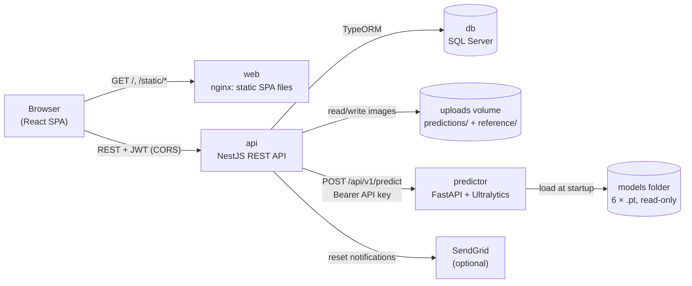
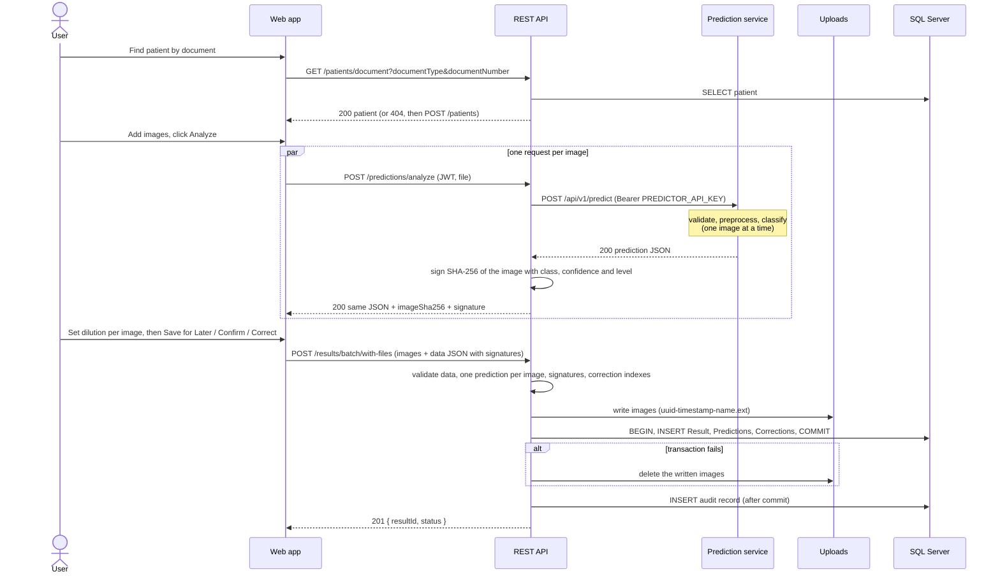
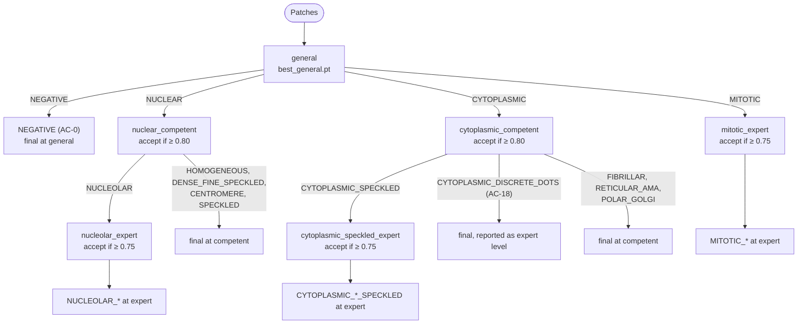
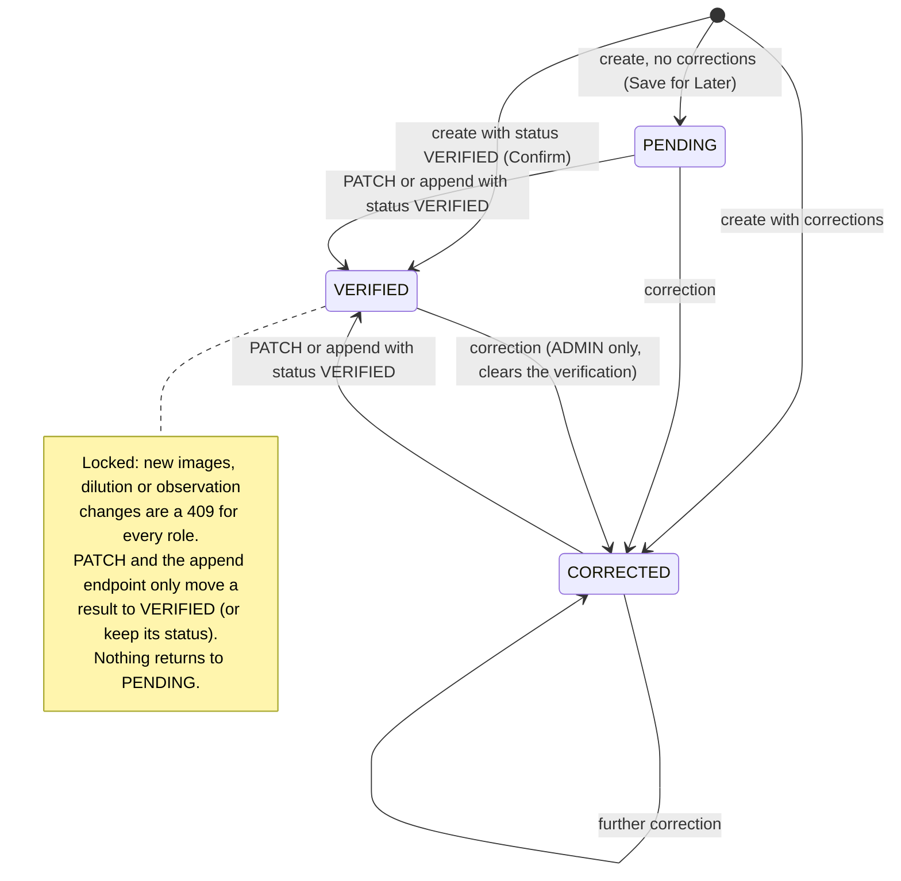
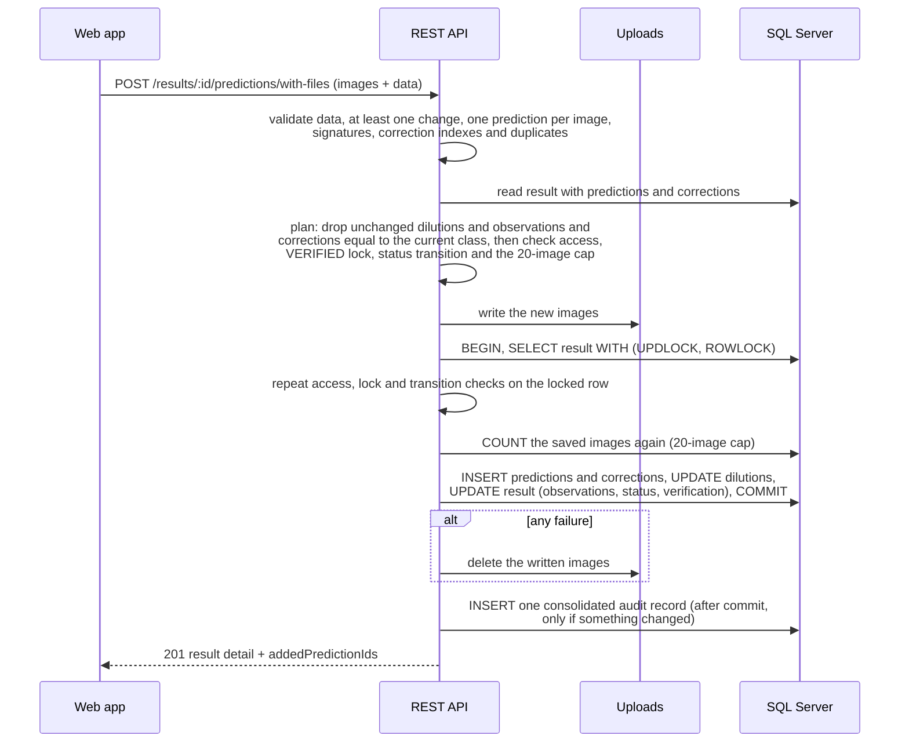
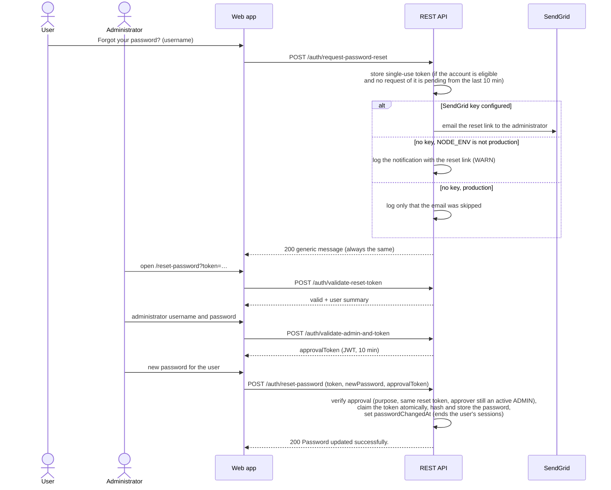
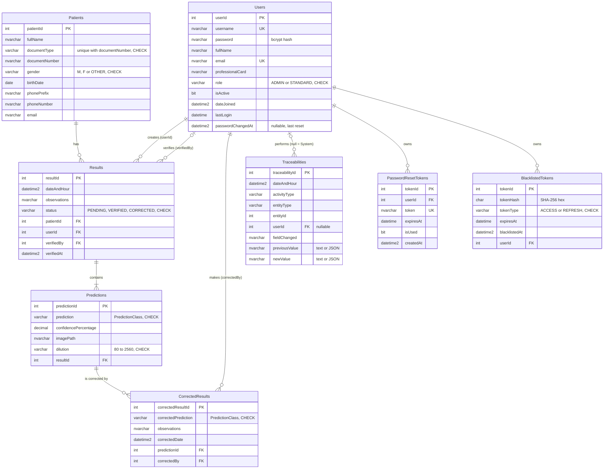

# Architecture

This document explains how the ANA Pattern Classifier is built and why. It is written from the
source code; file paths are given so each statement can be checked. The HTTP contract is in
[API.md](API.md).

## Contents

1. [Components](#1-components)
2. [Request flow of an analysis](#2-request-flow-of-an-analysis)
3. [Classification pipeline (api-predictor)](#3-classification-pipeline-api-predictor)
4. [Prediction proxy (api)](#4-prediction-proxy-api)
5. [Result lifecycle](#5-result-lifecycle)
6. [Audit trail](#6-audit-trail)
7. [Authentication and authorization](#7-authentication-and-authorization)
8. [Clinical report assembly](#8-clinical-report-assembly)
9. [Data model](#9-data-model)
10. [Web app structure](#10-web-app-structure)
11. [Design decisions and trade-offs](#11-design-decisions-and-trade-offs)

## 1. Components



The nginx container only serves the built SPA; the browser calls the API directly at
`REACT_APP_API_BASE_URL` (baked into the bundle at build time), and the API allows that origin
through CORS (`FRONTEND_URL`). The predictor is reachable only from the API.

| Component | Folder | Responsibilities |
|---|---|---|
| Web app | `frontend/` | Screens, client-side validation, role-aware navigation, token refresh, loading/empty/error states. No secrets. |
| REST API | `api/` | Authentication, role and record-level authorization, validation, patients, results, corrections, reports, audit trail, image storage, proxy to the predictor, password-reset workflow. |
| Database | SQL Server | Persistent data; schema created by TypeORM migrations only (`synchronize` is off). |
| Prediction service | `api-predictor/` | Image validation, preprocessing, patching, hierarchical YOLOv8 classification, hybrid voting. Stateless. |
| Uploads | `{UPLOADS_DIR}` of the API | `predictions/`: images of saved results. `reference/`: optional reference gallery ([README](../api/uploads/reference/README.md)). |
| Model checkpoints | `api-predictor/models/` | Six trained `.pt` files, not included in the repository because of their size; copied into the folder before running ([README](../api-predictor/models/README.md)). |
| Model training | Not included | The notebooks that trained the six checkpoints are offline and not part of this repository or of the running stack. |

## 2. Request flow of an analysis

The SPA analyzes each image as soon as the user asks for it, but nothing is stored until the
user saves. Saving sends the images again together with the predictions and the signature the
API issued for each one; corrections are separate items of the same request, so the model output
itself is never edited by the client.



"Continue Analysis" on a saved exam sends **one** `POST /results/:id/predictions/with-files`
request with everything pending: new images and their signed predictions, dilution edits,
corrections of new images (by index) and of saved predictions (by id), the observations and the
status. The API applies it in one transaction ([5.1](#51-changing-a-saved-result)); after a
success the web app turns the new images into saved predictions, so a retry never sends them twice
(`frontend/src/components/common/AnalysisPage.jsx`). **Verify** on Home uses `PATCH /results/:id`.

## 3. Classification pipeline (api-predictor)

Source: `api-predictor/app/services/prediction_service.py` and `app/core/class_mapping.py`.

### 3.1 Validation and preprocessing

1. **Request checks** (router): file extension in `ALLOWED_EXTENSIONS`, content type `image/*`;
   at most `MAX_FILE_SIZE` + 1 bytes are read.
2. **Image checks** (`validate_image`): not empty; not above `MAX_FILE_SIZE` (413); width ×
   height not above `MAX_IMAGE_PIXELS` (413, checked from the header **before** decoding, so a
   small compressed file cannot expand into a huge bitmap); fully decodable (`Image.load()`
   rejects truncated files).
3. **Mode normalization** (`_normalize_mode`): RGB and 8- or 16-bit grey images (`L`, `I;16*`)
   are kept; other grey modes (bilevel, grey with alpha) become `L`; palette, RGBA, CMYK and other
   colour modes become `RGB`, so channel 1 is always green. 32-bit integer (`I`) and
   floating-point (`F`) images are rejected with 400 `Unsupported image mode.`: they have no
   lossless 8-bit path, and OpenCV's PNG encoder would saturate them to black or white instead of
   failing, so a corrupted patch would still get a confident class. A mode Pillow cannot convert,
   or a result that is not 8-bit or 16-bit, gets the same 400.
4. **CLAHE** (colour images only): take the green channel, apply
   `cv2.createCLAHE(clipLimit=2.0, tileGridSize=(8, 8))`, then a 3 × 3 Gaussian blur. Single-channel images skip this step and go straight to patching.

### 3.2 Patching

`_create_patches(image, patch_size=640, overlap=0.4)`:

- stride = `int(640 × (1 − 0.4))` = 384 px, in both directions;
- only complete 640 × 640 windows are kept: a right or bottom margin narrower than a full
  window is not covered;
- an image smaller than 640 px in either dimension produces no window and is **resized** to one
  640 × 640 patch instead.

For example, a 1 280 × 1 024 image gives 2 × 2 = 4 patches (windows start at x = 0 and 384, y = 0
and 384) and leaves its right-most 256 px uncovered. The patches are created once and
reused at every level of the hierarchy. Each patch is written to a temporary 8-bit grayscale
PNG and classified by the Ultralytics model; the winning index is mapped to a class key through
`ModelConfig.MODELS[key]['classes']`.

### 3.3 Hybrid voting

For one model and `N` patches, let patch `i` have predicted class `cᵢ`, top-1 confidence `qᵢ` and
probability vector `pᵢ`.

**Mitotic rules** (general model only; they run first, in this order):

1. Let `rᵢ = pᵢ[MITOTIC]`. If `max rᵢ ≥ 0.70` **and** that patch's own prediction is `MITOTIC`,
   the result is `MITOTIC` with confidence `max rᵢ` (probabilities: that patch's vector).
2. Otherwise, if at least two patches have `rᵢ > 0.30` and the mean of those `rᵢ` is `≥ 0.50`,
   the result is `MITOTIC` with confidence equal to that mean (probabilities: the vector of the
   patch with the highest `rᵢ` among them).

`MITOTIC` is handled as a rare class: evidence in a few patches can win even when most patches
vote for another class.

**Standard vote** (every other case):

```text
m        = most frequent cᵢ                      (majority class)
s        = count(cᵢ = m) / N                     (majority strength)
wᵢ       = qᵢ / Σⱼ qⱼ                            (confidence weights)
P̄        = Σᵢ wᵢ · pᵢ                            (confidence-weighted mean probabilities)
F        = 0.6 · s · onehot(m) + 0.4 · P̄
F        = F / ΣF
class    = argmax F,  confidence = max F
```

The level result also reports `class_probabilities` (= `F`) and `patch_statistics` (vote count,
share and mean confidence per class; mean, minimum and maximum patch confidence).

### 3.4 Hierarchy

Three levels, six models. Thresholds (`ThresholdConfig`): general 0.85, competent 0.80,
expert 0.75. A lower-level result is accepted when its voted confidence is **≥** the threshold of
its level.



| Model key | Level | Next model |
|---|---|---|
| `general` | general | `NUCLEAR` → `nuclear_competent`, `CYTOPLASMIC` → `cytoplasmic_competent`, `MITOTIC` → `mitotic_expert`, `NEGATIVE` → none |
| `nuclear_competent` | competent | `NUCLEOLAR` → `nucleolar_expert`; others → none (`NUCLEAR_SPECKLED` has no trained expert model) |
| `cytoplasmic_competent` | competent | `CYTOPLASMIC_SPECKLED` → `cytoplasmic_speckled_expert`; others → none (`CYTOPLASMIC_FIBRILLAR` has no trained expert model) |
| `nucleolar_expert`, `cytoplasmic_speckled_expert`, `mitotic_expert` | expert | none |

**Fallback rules** (`_hierarchical_classification`). The general result is always accepted:
the 0.85 general threshold is only logged, never applied. Below it:

| Situation | Returned class | Level | `note` |
|---|---|---|---|
| General class `NEGATIVE` | `NEGATIVE` | general | none |
| Next model not loaded | general class | general | `No competent model is available for this class` (for `MITOTIC`: `No expert model is available for this class`) |
| Competent (or mitotic expert) confidence below its threshold | general class | general | `Low confidence at competent level (x% < 80.0%); classified at general level` (for `MITOTIC`: `… at expert level (x% < 75.0%) …`) |
| Error while running that level | general class | general | `Error at competent level; classified at general level` (for `MITOTIC`: `Error at expert level; …`) |
| Competent class `CYTOPLASMIC_DISCRETE_DOTS` (accepted at ≥ 0.80) | `CYTOPLASMIC_DISCRETE_DOTS` | **expert** | `AC-18 is an expert-level pattern detected by the competent model` |
| Competent class without an expert model | competent class | competent | `No expert model is available for this class` for `NUCLEAR_SPECKLED` and `CYTOPLASMIC_FIBRILLAR`, otherwise none |
| Expert model not loaded | competent class | competent | `No expert model is available for this class` |
| Expert confidence below 0.75 | competent class | competent | `Low confidence at expert level (x% < 75.0%); classified at competent level` |
| Error at expert level | competent class | competent | `Error at expert level; classified at competent level` |
| Expert confidence ≥ 0.75 | expert class | expert | none |

The response's `confidence`, `class_probabilities` and `patch_statistics` always come from the
level whose class is returned. `prediction` is the display name and `prediction_key` the class
key; the web app uses the key and never maps display names back.

With `ENABLE_HIERARCHICAL_CLASSIFICATION=false` only the general model runs.

### 3.5 Concurrency and model loading

- The six checkpoints load once, at application startup (FastAPI lifespan). A missing or broken
  checkpoint is logged and skipped; without the general model the service reports itself
  unavailable (`/api/v1/health` → 503, `/predict` → 503).
- Ultralytics models are not thread-safe, so inference runs in a worker thread through an
  `anyio.CapacityLimiter(1)`: **one image at a time per process**, while the event loop stays free
  (health checks keep answering during a long prediction).
- Tests never load a checkpoint: `tests/` replaces the models with fakes that return scripted
  probabilities.

## 4. Prediction proxy (api)

Source: `api/src/modules/predictions/predictor.client.ts`.

The SPA never calls the predictor. `POST /api/v1/predictions/analyze` accepts the image (same
type and size checks as result uploads), and `PredictorClient` forwards it with the server-side
key using Node's `fetch` and `FormData`:

- **Timeout:** `AbortSignal.timeout(PREDICTOR_TIMEOUT_MS)` per attempt (default 60 s). A timeout
  is not retried: the predictor is still busy and the client would give up first.
- **Retries:** network errors and HTTP 502, 503, 504 are retried at most twice, after 500 ms and
  1 000 ms.
- **Error mapping:** predictor 400/413/415 → the same status with the predictor's `detail`;
  401/403 → 502 `Prediction service misconfigured` (logged: wrong `PREDICTOR_API_KEY`); non-JSON
  success → 502; anything else → 503 `Prediction service unavailable, try again later`.
- **Success:** `PredictionSignatureService`
  (`api/src/modules/predictions/prediction-signature.service.ts`) checks that the answer has a
  non-empty `prediction_key` and a finite `confidence_percentage` (otherwise 502
  `Prediction service returned an invalid response`), sets `classification_level` to `"general"`
  when the predictor omits it, and adds `imageSha256` (lowercase hex SHA-256 of the image) and
  `signature`: base64url (no padding) HMAC-SHA256 keyed with `PREDICTION_SIGNING_SECRET` over
  `${imageSha256}|${prediction_key}|${confidence_percentage}|${classification_level}`, numbers
  rendered with JavaScript's `String()`. Nothing is stored at this point.

When results are saved, `POST /results/batch/with-files` and
`POST /results/:id/predictions/with-files` recompute the SHA-256 of each uploaded image and the
HMAC over it and the submitted `prediction`, `confidencePercentage` and `classificationLevel` of
the item at the same index, and compare it with the submitted `signature` in constant time
(`timingSafeEqual`). Any mismatch answers 400 `Prediction signature is invalid for image N.`
(`N` from 1, upload order) before a file is written or a row is inserted. The API refuses to
start without `PREDICTION_SIGNING_SECRET`, and a `change-me…` value counts as a placeholder
secret.

### 4.1 Why predictions are signed

The prediction stored with an exam is part of the clinical record: it is the model's output
against which corrections, the accuracy statistics and the report's final pattern are measured.
Analysis and saving are separate requests, so without a check a client could save a class or a
confidence the model never produced. The signature binds the class, the confidence and the level
to the exact image bytes, using a key that never leaves the API, so the client can return the
model's answer only unchanged and only with the image it belongs to. A user who disagrees with
the model changes the result through corrections, which keep the original prediction and are
recorded with their author in the audit trail.

## 5. Result lifecycle

Source: `api/src/modules/results/results.service.ts`.



| Transition | Endpoint | Who may do it |
|---|---|---|
| new → `PENDING` | `POST /results/batch/with-files` without corrections, `status` `PENDING` or omitted | ADMIN, STANDARD |
| new → `VERIFIED` | same endpoint with `status: "VERIFIED"`; the creator is recorded as verifier | ADMIN, STANDARD |
| new → `CORRECTED` | same endpoint with at least one correction (the `status` field is then ignored) | ADMIN, STANDARD |
| `PENDING` → `VERIFIED` | `PATCH /results/:id` or `POST /results/:id/predictions/with-files` with `status: "VERIFIED"` and no correction | ADMIN; STANDARD (any PENDING result) |
| `PENDING` → `CORRECTED` | `POST /results/corrections`, `/corrections/batch`, or the append endpoint with a correction | ADMIN; STANDARD (any PENDING result) |
| `VERIFIED` → `CORRECTED` | a correction (any of the three endpoints); `verifiedBy`/`verifiedAt` are cleared | ADMIN only; STANDARD gets 403 |
| `CORRECTED` → `CORRECTED` | a further correction | ADMIN; STANDARD on their own result |
| `CORRECTED` → `VERIFIED` | `PATCH /results/:id` or the append endpoint with `status: "VERIFIED"` and no correction | ADMIN; STANDARD on their own result |
| X → X (same status) | `PATCH /results/:id` or the append endpoint | Allowed, the status does not change |
| any other change | `PATCH /results/:id` or the append endpoint | Nobody: 409 `Invalid status transition from X to Y.` |

Rules enforced by the service:

- **Any stored correction sets the result to `CORRECTED` and clears its verification**
  (`verifiedBy`, `verifiedAt`), in the same transaction as the correction. A `CORRECTED` result
  therefore never carries a verification older than its latest correction.
- A result created with corrections is `CORRECTED` regardless of the requested status;
  `CORRECTED` cannot be requested directly at creation, nor through `PATCH` or the append
  endpoint: only corrections set it.
- **Status transitions are guarded** (`assertStatusTransition`, after the access rules):
  `PATCH /results/:id` and the append endpoint accept `PENDING` → `VERIFIED`,
  `CORRECTED` → `VERIFIED` and keeping the current status; everything else, including any move
  back to `PENDING` and `VERIFIED` → `CORRECTED` by status, is a 409.
- Entering `VERIFIED` from another status stores `verifiedBy` (current user) and `verifiedAt`.
- **Verified results are locked**: new images, changed dilutions and changed observations of a
  `VERIFIED` result answer 409 `Verified results cannot be modified.` for every role; values
  equal to the stored ones are no-ops. Only an ADMIN correction changes a verified result.
- STANDARD users see and act on their own results plus the shared PENDING queue; they can never
  correct a `VERIFIED` result.
- The "latest" correction of a prediction is chosen explicitly by `correctedDate` (newest), then
  by highest id (`api/src/common/utils/latest-correction.ts`); results, reports and the audit
  trail share this helper.

The web app uses these paths: **Save for Later** → `PENDING`; **Confirm** (no corrections) →
`VERIFIED`; **Correct** → `CORRECTED`; **Verify** on a pending exam from Home → `PATCH` to
`VERIFIED`.

### 5.1 Changing a saved result

`POST /results/:id/predictions/with-files` (`addPredictionsToResult`) turns one request into one
transaction:



- **The plan** is computed from the result as read before the transaction: a dilution equal to
  the stored one, observations equal to the stored text and a correction whose class equals the
  prediction's current class (latest correction, else the model class) are dropped, so only real
  changes reach the VERIFIED lock and the database.
- **Status.** Any stored correction writes `CORRECTED` with the verification cleared; otherwise a
  requested status follows the transition table, and `VERIFIED` records the verifier.
- **Race-free lock.** The status-dependent rules (STANDARD access, the VERIFIED lock, STANDARD
  corrections of a verified result, the transition) are checked once before the files are
  written and again on the row read with TypeORM's `pessimistic_write` lock, which SQL Server
  executes as `UPDLOCK, ROWLOCK`. A concurrent `PATCH`, correction or append of the same result
  waits for the lock, so a verification cannot slip in between the check and the write. `PATCH
  /results/:id` and the two correction endpoints use the same locked re-check.
- **Image cap.** A result holds at most 20 images (`MAX_IMAGES_PER_RESULT`), saved ones
  included: checked before the files are written and counted again under the lock, so two
  concurrent appends cannot exceed it together (`400 "A result can hold at most 20 images."`).
- **No-op requests.** A request whose values all equal the stored ones writes nothing, not even
  an audit record.
- The response lists `addedPredictionIds` in upload order, so the client can map its images to
  the stored predictions.

## 6. Audit trail

Source: `api/src/modules/traceability/traceability.service.ts`, table `Traceabilities`.

**What is recorded:**

| Entity | Activity | Written by | Stored values |
|---|---|---|---|
| USER | `CREATE` | `POST /users`, seed script | New-value snapshot (username, full name, email, license number, role, active) |
| USER | `UPDATE` | `PATCH /users/:id`, `DELETE /users/:id` | One record per changed field (`fieldChanged`, previous, new) |
| USER | `PASSWORD_RESET_REQUEST` / `PASSWORD_RESET_COMPLETED` / `PASSWORD_RESET_EXPIRED` | Reset workflow | Fixed text; the completed reset is attributed to the approving administrator |
| PATIENT | `CREATE`, `UPDATE`, `DELETE` | Patients endpoints | Snapshot, per-field changes, or deletion snapshot (name, document, email) |
| RESULT | `CREATE` | Result creation | Result fields, patient snapshot, every prediction and every correction |
| RESULT | `UPDATE` (per field) | `PATCH /results/:id` | `status` and/or `observations` changes (a cleared value is recorded) |
| RESULT | `UPDATE` (consolidated) | `POST /results/:id/predictions/with-files` | One record with previous and new JSON snapshots (status, observations), every prediction, the added predictions, the corrections stored by the request and one entry per changed dilution; none when the request changes nothing |
| CORRECTION | `CREATE` | Single correction | Entity id = correction id; original and corrected class, result id |
| CORRECTION | `CREATE` | Batch correction | Entity id = **result** id; previous and new result status, patient snapshot, every correction |

Logins, logouts and read access are not recorded.

**Design rules:**

- **Snapshots, not only references.** Create/delete records and consolidated updates store
  JSON snapshots (patient data, predictions, image URLs), so a record still shows what happened
  after the patient or result changed. The detail view combines the stored snapshot with
  current data (for example the current correction of each stored prediction).
- **Only real changes.** Per-field updates compare old and new values and skip unchanged fields
  and bookkeeping fields (`password`, `dateAndHour`, `dateJoined`, `lastLogin`, `correctedDate`,
  `createdAt`, `updatedAt`).
- **Sensitive fields stripped.** `password`, `token` and `refreshToken` are removed from every
  snapshot before it is stored.
- **System actor.** `userId` is nullable: actions without a signed-in user (the seed script) are
  stored with `null` and shown as "System". The foreign key uses `ON DELETE SET NULL`.
- **Best effort, after commit.** Audit records are written after the business transaction
  commits; a failure to write one is logged and never fails the user's request.
- **Plain or JSON values.** `previousValue`/`newValue` hold either a JSON object or a plain
  string; only values that look like JSON objects are parsed.
- **Read access.** Only ADMIN users can list or open audit records. The list returns codes
  (`activityType`, `entityType`) and display labels; the web app branches on the codes. It is
  filtered in the database by an instant range (`from` inclusive, `to` exclusive), the actor's
  full name and the activity type; the web app converts the chosen days to instants in the
  browser's time zone and exports every matching record by paging with the same filters.

## 7. Authentication and authorization

Source: `api/src/modules/auth/`.

**Tokens.** Login (`passport-local`, bcrypt comparison, active users only) returns an access
token and a refresh token, both HS256 JWTs signed with `JWT_SECRET`:

| Token | Claims | Lifetime | Accepted by |
|---|---|---|---|
| Access | `sub`, `username`, `role`, `jti` | `JWT_ACCESS_EXPIRATION` (default 15m; `env.example` 40m) | Every protected route |
| Refresh | same (own `jti`) + `type: "refresh"` | `JWT_REFRESH_EXPIRATION` (default 7d; `env.example` 2h) | `POST /auth/refresh-access`, `POST /auth/logout` |
| Reset approval | `sub` (admin), `purpose: "password-reset-approval"`, `resetTokenId` | 10 minutes | `POST /auth/reset-password` |

`jti` is a random UUID (`crypto.randomUUID()`) generated for every access and refresh token,
including the access tokens issued by a refresh, so two tokens are never identical even when the
same user signs in twice within one second.

The JWT strategy (`strategies/jwt.strategy.ts`) accepts only access tokens (no `type` other than
`access`, no `purpose`), requires well-formed `sub`, `username` and `role` claims, rejects
revoked tokens, and then loads the user: a missing or inactive user gets
401 `User not found or inactive.`, and a token issued before the user's last password reset gets
401 `The session ended because the password was changed.`. The role attached to the request is
the one **stored in the database**, not the token's `role` claim.

**Sessions end on password reset.** A completed reset stores `Users.passwordChangedAt`; the JWT
strategy and the refresh endpoint reject every access or refresh token whose `iat` is earlier
(`password-change.ts`). `iat` has one-second resolution, so a token issued in the same second as
the reset, even just after it, is rejected too (fail safe); a new login a second later works.

**Timing.** `PasswordService.validatePassword` runs one bcrypt comparison against a dummy hash
(same cost, created on first use) when the username is unknown, so login and the administrator
approval step take about as long for an unknown username as for a wrong password.

**Rate limits** (`auth-rate-limit.ts`, `@nestjs/throttler`). Three named throttlers count
requests per client IP and per route over a fixed window (`AUTH_RATE_LIMIT_WINDOW_SECONDS`,
default 60 s): `auth-login` (login, 10), `auth-refresh` (refresh-access, 30) and
`auth-password-reset` (request-password-reset, validate-admin-and-token and reset-password,
5 each). The throttler guard runs before the login's credential check, so failed attempts count.
Above the limit the API answers 429 `Too many requests. Please try again later.` with a
`Retry-After-<name>` header. The client IP is Express's `req.ip`; `TRUST_PROXY` sets Express
`trust proxy` for deployments behind a reverse proxy and is left unset otherwise, so a spoofed
`X-Forwarded-For` is ignored. Counters live in the memory of the API process.

**Revocation (per token).** Logout stores the SHA-256 hash of the refresh token **and** of the
request's access token in `BlacklistedTokens`, with each token's own expiry. Every protected
request and every refresh looks the hash up (indexed column). Because every token has its own
`jti`, revoking one session does not affect the user's other sessions, even concurrent ones.

**Cleanup job.** `AuthTokenCleanupService` runs at module start and then every hour
(`setInterval`, cleared on shutdown): it deletes blacklisted tokens whose `expiresAt` has passed
and password-reset tokens that are expired or used. Failures are logged.

**Authorization.** Every controller declares `@UseGuards(PassportJwtAuthGuard, RolesGuard)` and
`@Roles(...)`. Record-level rules (STANDARD users and results) live in the results service. The
SPA also hides admin pages (`ProtectedRoute roles={['ADMIN']}` shows a 403 page), but the API is
the enforcement point.

**Deactivation and role changes.** Deactivated users cannot log in or refresh, and because the
access-token check reads the user row on every request, a deactivated user loses access
immediately, not when the token expires. A demotion or promotion also applies from the next
request.

**Administrator-approved password reset.** Users cannot reset their own password by email; an
administrator approves every reset:



Checks: the request endpoint answers identically whether or not the account exists (the real
outcome is logged); reset tokens are 32 random bytes, single-use, and invalidate earlier unused
tokens of the same user; while the user has an unused, unexpired token created in the last
10 minutes, a new request neither creates a token nor voids the pending one, so repeated requests
cannot flood the administrator or invalidate a link already sent; every step writes an audit
record. The eligible path still does more work (token write, email, audit record) than an unknown
username, so the response time of the request endpoint can differ; the rate limit and the
cooldown slow down probing but do not remove that difference.

Without SendGrid (`SENDGRID_API_KEY` empty or `change-me…`), `EmailService` sends nothing. Outside
production it logs the administrator notification, including the reset link, at WARN level, so a
local installation can finish the flow; with `NODE_ENV=production`, which the API Docker image
sets, it logs only that the email was skipped, so reset links never reach production logs and a
Compose installation needs a SendGrid key for password resets.

**Other protections.** `helmet` security headers on every API response; CORS limited to
`FRONTEND_URL`; global validation with unknown properties rejected; placeholder secrets
(`change-me…` values of `JWT_SECRET`, `SENDGRID_API_KEY`, `PREDICTOR_API_KEY`,
`PREDICTION_SIGNING_SECRET`) produce a startup warning and stop the API when
`NODE_ENV=production`; original upload names never reach the logs (only the opaque
`<uuid>-<timestamp>` prefix of the stored name and file-system error codes); no HTTP route
deletes files.

**Database access.** Under Compose, the one-shot `db-init` service (`docker-compose.yml`) runs as
`sa`: it validates `DB_NAME` and `DB_APP_USERNAME` as plain identifiers, refuses `sa` as the
application login, creates the database if missing, creates the login `DB_APP_USERNAME` (or
resets its password to `DB_APP_PASSWORD`, so the password in `.env` always wins) and maps it to a
database user with `db_owner` on `DB_NAME` only. The API connects with that login, never `sa`.
Transport encryption comes from `DB_ENCRYPT` (default `false`) and
`DB_TRUST_SERVER_CERTIFICATE` (default `true`), which suit the private Compose network; production
should use `true` and `false` with a certificate the API trusts.

## 8. Clinical report assembly

Source: `api/src/modules/reports/reports.service.ts`.

A report is a `VERIFIED` or `CORRECTED` result. `GET /reports/:id` builds it as follows:

1. Load the result with patient, creator, verifier, predictions and their corrections.
2. **Every** prediction is listed, ordered by id. For each one, the **final pattern** is its
   latest correction (newest `correctedDate`, then highest id), otherwise the model prediction.
3. **Responsible physician** (`medic`): compare the latest correction of the whole result with
   the verification (`verifiedBy`, `verifiedAt`); the user who acted **last** is responsible. With
   only one of them, that user; with neither, the creator of the result.
4. **`lastModifiedAt`**: the latest of the result date, the latest correction date, the
   verification time, and the latest `UPDATE` audit record of the result (status or
   observation changes, appended images).

The web app renders the report in `frontend/src/components/reports/ReportModal.jsx`, with the
laboratory identity from `REACT_APP_LAB_*`. The modal is rendered directly into `<body>`, which
carries the class `report-print-active` while it is open; its **Print** button calls
`window.print()`, and the `@media print` rules in `frontend/src/index.css` then print only the
report: A4 pages with margins, black text on white, without the app, the overlay or the buttons,
and without splitting the header, an image card, the observations or the signature block across
pages.

## 9. Data model

Source: `api/src/entities/**` and the migrations in `api/src/modules/database/migrations/`:

| Migration | Change (each one has a `down()` that reverts it) |
|---|---|
| `1790286425611-Initial.ts` | The whole initial schema: tables, keys, indexes, referential actions and the CHECK constraints of the class columns |
| `1790300000000-PasswordChangedAt.ts` | Adds the nullable `Users.passwordChangedAt` (`datetime2`); existing users keep `NULL`, so their tokens stay valid until a reset |
| `1790300000001-CheckConstraints.ts` | Adds `WITH CHECK` constraints for the enumerated columns (list below), with the same names as the entities' `@Check` decorators |



**Referential actions** (explicit in the migration):

| Foreign key | On delete |
|---|---|
| `Results.patientId` → `Patients` | NO ACTION (a patient with results cannot be deleted; the API answers 409) |
| `Results.userId` → `Users` | NO ACTION |
| `Results.verifiedBy` → `Users` | SET NULL |
| `Predictions.resultId` → `Results` | CASCADE |
| `CorrectedResults.predictionId` → `Predictions` | CASCADE |
| `CorrectedResults.correctedBy` → `Users` | NO ACTION |
| `Traceabilities.userId` → `Users` | SET NULL |
| `PasswordResetTokens.userId` → `Users` | CASCADE |
| `BlacklistedTokens.userId` → `Users` | CASCADE |

**CHECK constraints.** The class columns `Predictions.prediction` and
`CorrectedResults.correctedPrediction` accept only `PredictionClass` keys (initial migration). The
`CheckConstraints` migration adds:

| Constraint | Allowed values |
|---|---|
| `CHK_Results_status` | `PENDING`, `CORRECTED`, `VERIFIED` |
| `CHK_Predictions_dilution` | `80`, `160`, `320`, `640`, `1280`, `2560` |
| `CHK_Patients_documentType` | `NATIONAL_ID`, `MINOR_ID`, `FOREIGNER_ID`, `PASSPORT`, `BIRTH_CERTIFICATE` |
| `CHK_Patients_gender` | `M`, `F`, `OTHER` |
| `CHK_Users_role` | `ADMIN`, `STANDARD` |
| `CHK_BlacklistedTokens_tokenType` | `ACCESS`, `REFRESH` |

The value lists are frozen in the migration on purpose (a later enum change needs its own
migration); a unit test checks that they match the enums and the entity decorators. They are
created `WITH CHECK`, so existing rows are validated and the constraints are trusted.

**Indexes:** `Results(status, dateAndHour)`, `Predictions(resultId)`,
`CorrectedResults(predictionId)`, `Traceabilities(entityType, entityId)`,
`Traceabilities(dateAndHour)`, `PasswordResetTokens(userId)`, `BlacklistedTokens(tokenHash)`;
unique: `Users.username`, `Users.email`, `Patients(documentType, documentNumber)`,
`PasswordResetTokens.token`.

Timestamps default to `SYSUTCDATETIME()` and the driver runs with `useUTC: true`, so every stored
time is UTC; clients format it in their own time zone. Users are never deleted by the
application (deactivation only). Image files live on disk; the database stores their file name
(`Predictions.imagePath`).

## 10. Web app structure

Source: `frontend/src/`.

| Area | Files | Notes |
|---|---|---|
| Routing | `routes/AppRouter.jsx`, `routes/auth/ProtectedRoute.jsx` | `/login`, `/reset-password`, `/dashboard/{home,analysis,reports,audit-trail,analytics,users}`; the last three require ADMIN |
| Session | `context/AuthContext.jsx`, `services/utils/tokenStorage.js` | Access token, refresh token and user profile are kept in `localStorage` |
| HTTP | `config/axios.js` | Adds the bearer token; on a 401, one refresh request shared by every concurrent 401 (10 s timeout), then the original requests are retried. Only a 401 from the refresh ends the session; any other refresh failure (network, timeout, 429, 5xx) keeps the tokens and fails the original request |
| Services | `services/api/*.js` | One module per API area; errors read the NestJS `message` (see `services/utils/apiErrors.js`); a 429 always shows "Too many requests. Please try again later.", and a 409 shows the API message (by default "Verified results cannot be modified.") |
| Images | `hooks/useAuthorizedImage.js` | Protected images are fetched with the auth header and shown as blob URLs (revoked on cleanup) |
| Classes | `config/classMapping.js` | Class keys → AC codes and display names; mirrors the predictor's `ACMapping` |
| Analysis | `components/common/AnalysisPage.jsx`, `components/common/VerifyResultsModal.jsx`, `services/api/predictionService.js`, `services/utils/analysisPayload.js` | Keeps each image's `prediction_key`, exact `confidence_percentage`, `classification_level` and `signature` by image id; an answer without `confidence_percentage` or with an unknown class marks the image as failed; re-analyzing an image replaces its signature; an image without a signature must be analyzed again before saving. At most 20 images per result (saved ones included; extra files are refused with a message). A continued exam is saved with one append request (a dilution change of a saved image may be sent on its own); the page Observations are the result's (blank sends `null`), the Correction Notes go only to the corrections, and the model's class is never offered as a correction. The verify modal cannot be closed while a save runs; after a 409 the page reloads the result's current state |
| Unsaved work | `context/NavigationGuardContext.jsx`, `components/layout/DashboardLayout.jsx`, `components/layout/DashboardSidebar.jsx` | While the analysis page holds unsaved images or edited observations or dilutions, the sidebar links and **Log Out** ask "Leave Without Saving?" and the browser asks before a reload or closing the tab (`beforeunload`). `BrowserRouter` has no navigation blocker, so the browser's Back and Forward buttons are not guarded |
| Home and audit trail | `pages/Dashboard/DashboardHome.jsx`, `hooks/useResults.js`, `pages/Dashboard/DashboardTraceability.jsx`, `services/utils/traceabilityUtils.js` | Home searches pending exams on the server (`search`, debounced, from page 1). The audit trail sends its filters to the server (actor name debounced; days converted to local-midnight instants; a start date after the end date is flagged on the field, not sent, and disables the export) and its CSV export pages through every matching record, 100 per request |
| Compare | `components/ui/CompareImageModal.jsx` | Reference gallery; opens on the image's predicted class when the gallery has images for it, otherwise on the first available class |
| Report | `components/reports/ReportModal.jsx`, `index.css` | Clinical report modal with a **Print** button and an A4 print stylesheet |

## 11. Design decisions and trade-offs

| Decision | Why | Cost |
|---|---|---|
| Three-level hierarchy of small classifiers instead of one flat 24-class model | Follows the ICAP taxonomy (compartment → pattern → sub-pattern); each model only separates a few related classes; a low-confidence sub-classification falls back to a coarser answer instead of guessing | Up to three models per image; untrained branches (AC-4/AC-5 and AC-15–17 sub-patterns) stop at competent level |
| Patches with 40 % overlap and hybrid voting | Full-resolution fields are larger than the model input; voting over patches is robust to empty or out-of-focus regions | Margins narrower than a window are not seen; inference time grows with image size |
| Special mitotic rules | `MITOTIC` is treated as a rare class that a plain majority vote over patches would miss | Heuristic thresholds (0.70, 0.30, 0.50) are fixed in code |
| Predictor behind the API | The predictor key never reaches the browser; one place for authentication, roles, validation, retries and error mapping | One extra network hop per image |
| One inference at a time per predictor process | Ultralytics models are not thread-safe; the worker thread keeps health checks responsive | Throughput is one image at a time; scaling means more predictor processes |
| Per-patch temporary PNG | Keeps the preprocessing path that produced the reference outputs the service was verified against; an in-memory path would need re-verification | Disk I/O per patch |
| CPU-only PyTorch in the lockfile | Reproducible Linux install without CUDA libraries | No GPU acceleration out of the box |
| Signed predictions (HMAC over image hash, class, confidence and level) | Analysis and saving stay separate steps, yet the stored model output cannot be forged by the client; users change a pattern only through audited corrections ([4.1](#41-why-predictions-are-signed)) | One more secret to manage; the client must keep the exact analysis values until it saves |
| Guarded status transitions and a locked `VERIFIED` state | A verified result cannot silently return to pending or change after verification; `CORRECTED` always has a correction behind it, and a correction clears the verification it invalidates | A verified result never returns to pending; it changes only through an administrator's correction |
| Transactions for multi-row writes, audit after commit | No orphan results or files; audit logging never blocks clinical work | An audit record can be missing if its own insert fails (logged) |
| One append request per save, re-checked under `UPDLOCK` | A continued exam is saved all-or-nothing and can be retried; a concurrent verification cannot be overwritten | Concurrent writers of the same result wait for each other |
| Server-side search and audit filters | Search and export cover every record, not only the loaded page | One request per search change (debounced) and per exported page |
| Per-IP rate limits in memory (`@nestjs/throttler`) | Slows password guessing and reset-link probing without extra infrastructure | Counters are per API process and reset on restart; behind a proxy `TRUST_PROXY` must be set |
| Dedicated SQL login with `db_owner` on one database | The API cannot touch other databases or server settings, and never holds `sa` | One more secret (`DB_APP_PASSWORD`); `db_owner` is still needed because the API applies its migrations |
| Audit snapshots | Records stay meaningful after data changes | Patient data is duplicated into the audit table |
| Database token blacklist, `jti` per token | Per-session logout with stateless JWTs | One indexed lookup per request |
| User row read on every request | Deactivation and role changes take effect at once | One more database lookup per request |
| Administrator-approved reset | No self-service email reset to secure; an administrator confirms identity | Needs SendGrid in production (outside production the link is logged) and an available administrator |
| Migrations only, UTC storage | Reproducible schema with explicit constraints; no time-zone drift between hosts | Schema changes need a migration |
| No sample images shipped | Clinical images are personal data | The reference gallery is empty until the laboratory adds licensed images |
